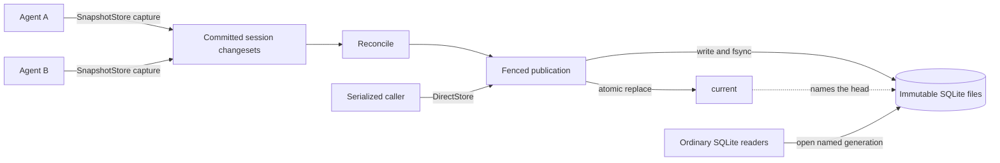

# fsqlite

[](https://x.com/ojoshe)
[](https://github.com/jlevy/fsqlite/actions/workflows/ci.yml)

**Portable, stable SQLite, packaged for concurrent local agents.**

fsqlite packages SQLite for workflows with many local agents: point cooperative
processes at a store directory and use familiar SQL, schemas, constraints, tools, and
SQLite files. SQLite itself runs every transaction, and each immutable generation is a
complete standard SQLite database that ordinary tools and bindings can open directly.
A language-independent commit protocol coordinates independent transaction capture and
server-free publication; the first reference implementation is a zero-runtime-dependency
Node.js library.

> **Alpha phase:** `0.1.0` defines the first public API and draft `f1.0` format.
> Both may change before 1.0. Local POSIX multi-process behavior has extensive automated
> coverage, but the real cross-host NFS/SMB gate and Windows publication-race validation
> are still pending.

## Why fsqlite Exists

A single computer can run many independent database clients.
A local workspace may have an interactive application, coding agents, background
indexers, research agents, and automation processes updating the same knowledge base,
task graph, document catalog, or cache.
Those writers may have substantial contention even though every process is local, and
running a database server beside every workspace is often disproportionate.

The usual choices leave a gap:

- Ordinary SQLite is excellent when writers can queue on one live database file.
  It provides immediate, serializable commits and efficient page-level writes, but it
  still has one active writer and relies on the live-file locking and journaling model
  of the target filesystem.
- Distributed SQLite systems commonly add a primary, daemon, consensus cluster, storage
  service, custom engine, or reader extension.
  Those are reasonable designs, but they change deployment or artifact portability.
- JSON, JSONL, and ad hoc lock files remain easy to move, but they do not provide
  SQLite’s schema, queries, constraints, transactions, and tooling.

## Core Properties

fsqlite combines a different set of properties:

- **Portable SQLite files:** Every published generation is a complete database in the
  standard SQLite format.
  It moves unchanged across architectures and operating systems, opens with ordinary
  SQLite tools and bindings, and can be sealed as a plain file for archival or migration
  between environments.
- **Stable SQLite foundation:** The SQLite 3 file format has been
  [backward compatible since 2004](https://sqlite.org/formatchng.html), and the SQLite
  project [plans support through 2050](https://sqlite.org/lts.html).
  fsqlite retains SQLite’s [widely deployed](https://sqlite.org/mostdeployed.html)
  engine, SQL, transactions, schema, constraints, tooling, and file ecosystem.
- **SQLite-native change capture:** `SnapshotStore` uses SQLite’s official
  [session extension](https://sqlite.org/sessionintro.html) to record row transactions
  in private copies and apply them with SQLite’s conflict-aware changeset API. Sessions
  are less familiar than WAL, but this upstream feature has shipped in the SQLite
  amalgamation since 3.13.0 in 2016. For cooperative local clients that write
  independently in separate copies, sessions are SQLite’s native way to capture and
  merge row changes; fsqlite adds the atomic publication protocol around them.
- **Concurrency-safe publication:** Immutable generations, an atomic `current` pointer,
  fencing, optimistic publication, and an exactly-once ledger protect published state
  through process crashes and racing publishers.
- **Server-free operation:** Deployment needs only cooperative processes and a store
  directory; no database server, daemon, or background service is required.
- **Language-independent protocol:** The on-disk format and commit protocol can be
  implemented in any language; Node.js is the first reference implementation.

## What fsqlite Adds to SQLite

fsqlite keeps SQLite intact and adds a file-level coordination layer:

| Layer | Supplied by | Role |
| --- | --- | --- |
| Database engine and file format | SQLite | SQL, transactions, schemas, constraints, queries, and complete portable database files |
| Logical change capture | SQLite session extension | Records row changes and applies them later with conflict detection |
| Store and commit protocol | [`f1.0`](docs/fsql-format-spec.md) | Transaction envelopes, immutable generations, `current`, fencing, validation, an exactly-once ledger, and quarantine |
| Reference package | TypeScript on built-in `node:sqlite` | A convenient npm library and CLI that implements the protocol for Node applications and agents |

The durable artifact is a standard SQLite database plus the surrounding `f1.0` directory
protocol. fsqlite defines no new storage engine or SQL dialect.
Ordinary readers open the published SQLite file directly; cooperative writers use
fsqlite to coordinate which complete file is current and how independent changes reach
it.

### Why This Is Practical Now

SQLite’s session extension has been upstream since 2016, but it is compile-time optional
and remains absent from many common bindings.
That kept logical changesets less visible than WAL and page replication.
Node’s built-in `node:sqlite` now exposes sessions, changeset application, backup, and
ordinary SQLite access together, which makes a small zero-dependency package practical.

Most distributed SQLite systems chose a different deployment model: WAL or page
replication, a primary or daemon, consensus, a storage service, or custom readers.
fsqlite combines SQLite’s row-level changesets with immutable generations and an atomic
filesystem commit point.
The individual pieces are established; the `f1.0` protocol and their server-free
integration are the new contribution.
The [research report](docs/research/research-2026-06-06-portable-concurrent-sqlite.md)
contains the source analysis, prior-art review, and comparison matrix behind this
design.

## Choose a Storage Model

Choose a storage model from the way writers coordinate and when updates must become
visible. A single machine can have many independent writers, while several callers can
sometimes share one serialized writer lane.
Writer independence, visibility, isolation, snapshot size, and write cadence determine
the fit:

Here, an “agent” is an independently running cooperative process with its own store
handle. Threads sharing one SQLite connection belong to a different coordination model.

| Situation | Default choice | Why |
| --- | --- | --- |
| One embedded application owns a database on a reliable local filesystem | Ordinary SQLite, often with WAL | It is simpler, provides immediate serializable transactions, and writes changed pages instead of copying a complete snapshot. |
| Several independent local agents update compact shared state, captures may overlap, and visibility may wait for reconciliation | `SnapshotStore` | Each agent captures its transaction without the publish lease or a shared writable SQLite file; reconciliation merges and publishes the next immutable generation. |
| Cooperative callers can serialize the complete callback, need each return to be immediately published, and specifically value immutable generations or the fsqlite format | `DirectStore` | A filesystem lease serializes copy, transaction, validation, and publication. Multiple callers may queue, but only one write lane runs at a time. |
| Many writers need low-latency globally visible commits, high sustained throughput, rolling schemas, or serializable range and cross-row invariants | A client/server database or coordinator | Those requirements need a live coordination service or a different concurrency-control model. |

`SnapshotStore` is the main fsqlite strategy for the common multi-agent case.
It trades immediate visibility and serializability for independent capture and
file-native handoff.
`DirectStore` serves workloads that value immutable generations and immediate
publication enough to serialize every complete callback.
Ordinary SQLite remains the simpler choice for a single embedded owner.

The [coordination-model guide](docs/fsqlite-design.md#choose-by-coordination-model)
develops this decision from visibility, isolation, snapshot size, and writer
independence.

### Shared Filesystems and Cloud Agents

Safety on shared network storage depends on the capabilities of the exact mount.
Both strategies require correct exclusive directory creation, atomic rename-replace,
close-to-open visibility, and file and directory fsync behavior.
The alpha’s one-host `fsinspect` result is useful diagnostic evidence, not proof that an
arbitrary NFS or SMB deployment is safe across hosts.
Once a shared mount has real multi-host evidence, prefer `SnapshotStore` when local or
cloud agents should capture independently and converge later.
Prefer `DirectStore` when those agents can queue and each callback must observe the
latest published state.
Use a database service when the cloud environment makes one practical and the workload
needs immediate visibility, sustained throughput, or stronger transactions.
The [shared-path design](docs/fsqlite-design.md#shared-paths-and-cloud-agents) explains
the required filesystem evidence and deployment choices in detail.

## Architecture

An fsqlite store is a directory containing immutable SQLite generations, a `current`
pointer, and optional transaction envelopes:



`SnapshotStore.write()` runs a normal SQLite transaction on a private copy and records
the result with SQLite’s session extension.
It commits that changeset as a uniquely named envelope, so independent captures can
overlap. `reconcile()` applies accepted envelopes to another private copy, validates the
result, and publishes the next generation.
`DirectStore` skips the envelope step and serializes the complete copy-mutate-publish
path.

Replacing `current` is the store commit point.
The snapshot is written and fsynced first, so readers see either the previous complete
SQLite database or the next one.
Fencing, optimistic checks on `current`, and an in-snapshot transaction ledger protect
publication from racing publishers, stale leases, duplicate application, and process
crashes.
The protocol coordinates cooperative writers; processes that bypass fsqlite must
treat published snapshots as read-only.
`SnapshotStore` provides deterministic write-set conflict handling rather than
serializability across independently captured transactions.
The [architecture design](docs/fsqlite-design.md#architecture) covers the complete store
layout, publication races, and consistency boundaries.

### Reference Implementation

The reference implementation is a small set of TypeScript modules packaged for npm as
`fsqlite`. It has zero runtime dependencies and runs on Node’s built-in
[`node:sqlite`](https://nodejs.org/api/sqlite.html), filesystem, and cryptography APIs.
`node:sqlite` supplies SQLite, session changesets, and online backup without a native
add-on or prebuilt binary.

The `f1.0` format is language-independent, with Node serving as the first
implementation. Any SQLite binding can read a published generation.
A `SnapshotStore` implementation in another language needs SQLite session and changeset
support; a `DirectStore` implementation needs ordinary SQLite.
Either can implement the same filesystem protocol and interoperate through the same
store. The [upstream source confirmations](docs/upstream-source-confirmations.md) record
the exact SQLite and Node capabilities behind the reference package.

## Install

```bash
npm install fsqlite@alpha
```

Requires Node `>=22.18.0 <23 || ^24.0.0 || >=26.0.0`.

## Quick Start

```ts
import { SnapshotStore } from 'fsqlite'

const store = new SnapshotStore('./knowledge.fsqlite', {
  schema: `
    CREATE TABLE facts (
      key TEXT PRIMARY KEY NOT NULL,
      value TEXT NOT NULL
    )
  `,
  schemaVersion: 1,
  conflictPolicy: { facts: 'lww', '*': 'strict' },
}).init()

// Independent agents can capture envelopes without taking the publish lease.
store.write('research-agent', (db) => {
  db.prepare('INSERT INTO facts VALUES (?, ?)').run('answer', '42')
})

// Any cooperative participant or an orchestrator may reconcile the pending tail.
store.reconcile()

const row = store.read((db) =>
  db.prepare('SELECT value FROM facts WHERE key = ?').get('answer'),
)
console.log(row)
```

Every caller table needs a non-null primary key.
`SnapshotStore` callbacks may perform data changes but not DDL; an `f1.0` store has one
fixed caller-schema epoch.
The [package README](packages/fsqlite/README.md) documents installation, the full writer
contract, conflict policies, schema replacement, CLI operations, and limitations.

## Portable Sharing and Replication

The live store is a directory, but each published head is a complete ordinary SQLite
file. `seal()` pins a generation and creates an integrity-checked standalone SQLite copy
for handoff, archival, upload, or import into another environment.
Readers need no fsqlite extension.

fsqlite provides a stable file boundary that an application can move with its own
transport. Remote transport, consensus, and automatic bidirectional replication remain
application responsibilities.
Reconcile the desired pending work before sealing when the exported artifact must
include the complete accepted tail.
The [backup and copying design](docs/fsqlite-design.md#backup-and-copying) describes the
supported live-store and standalone-file workflows.

## Costs and Boundaries

- Each `SnapshotStore` capture copies the complete published head, and reconciliation
  copies it again. The natural alpha workload is compact state, occasional or bursty
  writes, and batched reconciliation, not a large high-throughput transactional
  database.
- A successful `SnapshotStore.write()` means the envelope was accepted.
  It becomes visible and power-loss durable only after reconciliation publishes it.
- `SnapshotStore` conflict policy resolves supported same-primary-key cases.
  It does not infer range, aggregate, predicate, or arbitrary cross-row invariants.
  `f1.0` also requires every reconciler to receive the same effective conflict policy;
  the store does not yet verify policy identity.
- Published snapshots are immutable and recoverable, but arbitrary recursive copying of
  a live store is not a supported backup contract.
- Multi-host NFS/SMB behavior, Windows publication races, schema migration, bounded
  ledger growth, a formal Worker Thread contract, and stronger isolation remain pre-1.0
  work.

The
[schema evolution and workload assessment](docs/research/research-2026-08-01-schema-evolution-and-workload-fit.md#practical-operating-envelope)
contains current measurements and adoption boundaries.

## Further Documentation

| Need | Document |
| --- | --- |
| Map guarantees to automated and manual evidence | [QA Runbook](docs/qa-runbook.md) |
| See remaining portability and stable-release work | [Roadmap](docs/roadmap.md) |
| Find every project document and its authority | [Documentation Map](docs/README.md) |
| Prepare a package release | [Release Runbook](docs/releasing.md) |

## Development

```bash
pnpm install --frozen-lockfile --ignore-scripts
pnpm verify
```

See [Contributing](CONTRIBUTING.md) for the focused commands and project invariants.

## License

MIT © 2026 Joshua Levy.

<!-- This document follows common-doc-guidelines.md.
See github.com/jlevy/practical-prose and review guidelines before editing.
-->
