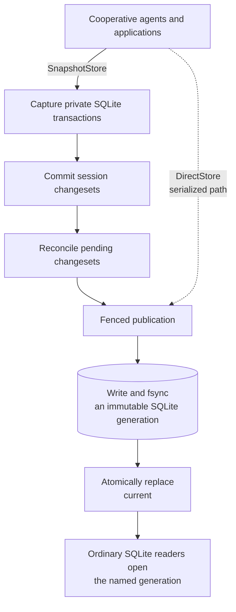

# fsqlite

[](https://x.com/ojoshe)
[](https://github.com/jlevy/fsqlite/actions/workflows/ci.yml)

**Portable, stable SQLite, packaged for concurrent agents.**

fsqlite is ordinary SQLite with a file-level coordination layer for concurrent agents.
It publishes complete databases as immutable versions, so writers do not share one live
SQLite file.

You keep SQLite’s engine, SQL, transactions, portable file format, standard tools, and
server-free operation.
fsqlite adds concurrency-safe publication for cooperative writers.
`seal()` can make a consistent point-in-time copy while publication continues; a
successful copy contains one complete version, and later work is outside that copy.

The Node reference package uses SQLite built into Node 22.18+ on 22.x, Node 24, or Node
26 and later, through the built-in [`node:sqlite`](https://nodejs.org/api/sqlite.html)
module. It requires no separate SQLite installation or native build.
fsqlite and direct `node:sqlite` calls use the same SQLite library; the `f1.0` commit
protocol is language-independent.

> **Alpha phase:** `0.1.0` defines the first public API and draft `f1.0` format.
> Both may change before 1.0. Local POSIX multi-process behavior has extensive automated
> coverage, but the real cross-host NFS/SMB gate and Windows publication-race validation
> are still pending.

## Why fsqlite Exists

A common agent setup puts one shared SQLite knowledge base on an NFS-backed workspace.
Several agents open the same path and write from separate processes.

Standard SQLite coordinates those writes with POSIX byte-range locks on one live
database file.
SQLite’s [network-filesystem guidance](https://sqlite.org/useovernet.html)
warns that exclusive locks can operate incorrectly on some network filesystems.
When the mount cannot provide the lock SQLite expects, the
[Unix VFS maps `ENOLCK` to `SQLITE_BUSY`](https://github.com/sqlite/sqlite/blob/002d33d8c569ce25f5001ae627a4e73dd52bf98d/src/os_unix.c#L1014-L1038)
and calls it a “random NFS retry error.”
In Node, a failed write looks like this:

> `Error: database is locked`
> ([`SQLITE_BUSY` (5)](https://sqlite.org/rescode.html#busy);
> [SQLite source](https://github.com/sqlite/sqlite/blob/002d33d8c569ce25f5001ae627a4e73dd52bf98d/src/main.c#L1649-L1657))

Waiting longer does not fix this: the NFS mount cannot supply the lock SQLite needs.
[A busy timeout](https://sqlite.org/pragma.html#pragma_busy_timeout) helps when another
process owns a working lock and will release it; it cannot make unavailable or
unreliable NFS locking work.
WAL is not a workaround because
[SQLite does not support WAL across a network filesystem](https://sqlite.org/wal.html#overview).
Some broken network locks can appear to work without coordinating clients correctly,
which risks database corruption.

fsqlite avoids the shared writable file.
Each agent works in a private SQLite file, and cooperative publishers expose complete
immutable generations through directory creation, no-replace hard links, and atomic
rename. On a mount that meets the
[`f1.0` publication contract](#shared-filesystems-and-cloud-agents), agents can share
and update ordinary SQLite data without a database server.

## Core Properties

fsqlite combines a different set of properties:

- **Portable SQLite files:** Every published generation is a complete database in the
  standard SQLite format.
  It moves unchanged across architectures and operating systems, opens with ordinary
  SQLite tools and bindings, and can be sealed as a plain file for archival or migration
  between environments.
- **Stable SQLite foundation:** The SQLite 3 file format has been
  [backward compatible since 2004](https://sqlite.org/formatchng.html), and the SQLite
  project [plans support through 2050](https://sqlite.org/lts.html).
  fsqlite retains SQLite’s [widely deployed](https://sqlite.org/mostdeployed.html)
  engine, SQL, transactions, schema, constraints, tooling, and file ecosystem.
- **SQLite included with Node:** Supported Node releases supply SQLite as part of the
  runtime and expose it through the built-in `node:sqlite` module.
  Application code and fsqlite use that same library.
  The npm package adds the coordination layer around it.
- **SQLite-native change capture:** `SnapshotStore` uses SQLite’s official
  [session extension](https://sqlite.org/sessionintro.html) to record row transactions
  in private copies and apply them with SQLite’s conflict-aware changeset API. Sessions
  are less familiar than WAL, but this upstream feature has shipped in the SQLite
  amalgamation since 3.13.0 in 2016. For cooperative clients that write independently in
  separate copies, sessions are SQLite’s native way to capture and merge row changes;
  fsqlite adds the atomic publication protocol around them.
  `SnapshotStore`’s only SQLite-build-specific requirement is `SQLITE_ENABLE_SESSION`
  with `SQLITE_ENABLE_PREUPDATE_HOOK`; supported Node versions enable both.
  Readers and `DirectStore` need ordinary SQLite only.
- **Concurrency-safe publication:** Immutable generations, an atomic `current` pointer,
  fencing, optimistic publication, and an exactly-once ledger protect published state
  through process crashes and racing publishers.
- **Server-free operation:** Deployment needs only cooperative processes and a store
  directory; no database server, daemon, or background service is required.
- **Language-independent protocol:** The on-disk format and commit protocol can be
  implemented in any language; Node.js is the first reference implementation.

## What fsqlite Adds to SQLite

fsqlite keeps SQLite intact and adds a file-level coordination layer:

| Layer | Supplied by | Role |
| --- | --- | --- |
| Database engine and file format | SQLite | SQL, transactions, schemas, constraints, queries, and complete portable database files |
| Logical change capture | SQLite session extension | Records row changes and applies them later with conflict detection |
| Store and commit protocol | [`f1.0`](docs/fsql-format-spec.md) | Transaction envelopes, immutable generations, `current`, fencing, validation, an exactly-once ledger, and quarantine |
| Reference package | TypeScript and Node built-ins | Uses Node’s included SQLite and implements the protocol as a convenient npm library and CLI |

The durable artifact is a standard SQLite database plus the surrounding `f1.0` directory
protocol. fsqlite defines no new storage engine or SQL dialect.
Ordinary readers open the published SQLite file directly; cooperative writers use
fsqlite to coordinate which complete file is current and how independent changes reach
it.
In Node, both paths execute against the same SQLite library that direct `node:sqlite`
calls use.

## Why fsqlite Is Practical Now

SQLite’s session extension has been upstream since 2016, but it is compile-time optional
and remains absent from many common bindings.
That kept logical changesets less visible than WAL and page replication.
Node releases supported by fsqlite include SQLite compiled with `SQLITE_ENABLE_SESSION`
and `SQLITE_ENABLE_PREUPDATE_HOOK`. The built-in `node:sqlite` module exposes sessions,
changeset application, backup, and ordinary SQLite access together.
Node supplies the database engine and native integration; fsqlite supplies the
TypeScript coordination layer.
That division makes a small zero-runtime-dependency npm package practical.

Most distributed SQLite systems chose a different deployment model: WAL or page
replication, a primary or daemon, consensus, a storage service, or custom readers.
fsqlite combines SQLite’s row-level changesets with immutable generations and an atomic
filesystem commit point.
The individual pieces are established; the `f1.0` protocol and their server-free
integration are the new contribution.
The [research report](docs/research/research-2026-06-06-portable-concurrent-sqlite.md)
contains the source analysis, prior-art review, and comparison matrix behind this
design.

## Choose a Storage Model

Here, an “agent” is an independently running cooperative process with its own store
handle. Threads sharing one SQLite connection belong to a different coordination model.
A fixed dataset can be shared directly as a read-only SQLite file.
fsqlite becomes relevant when the shared data evolves: cooperative writers need a safe
publication path while agents continue reading complete generations.

Choose a storage model from the way writers coordinate and when updates must become
visible. A single machine can have many independent writers, while several callers can
sometimes share one serialized writer lane.
Writer independence, visibility, isolation, snapshot size, and write cadence determine
the fit:

| Situation | Default choice | Why |
| --- | --- | --- |
| One embedded application owns a database on a reliable local filesystem | Ordinary SQLite, often with WAL | It is simpler, provides immediate serializable transactions, and writes changed pages instead of copying a complete snapshot. |
| Several independent agents update compact shared state on a local or capability-validated shared path, captures may overlap, and visibility may wait for reconciliation | `SnapshotStore` | Each agent captures its transaction without the publish lease or a shared writable SQLite file; reconciliation merges and publishes the next immutable generation. |
| Cooperative callers need immutable generations or use a capability-validated path without reliable SQLite locks, can serialize the complete callback, and need each return to be immediately published | `DirectStore` | A filesystem lease serializes copy, transaction, validation, and publication. Multiple callers may queue, but only one write lane runs at a time. |
| Many writers need low-latency globally visible commits, high sustained throughput, rolling schemas, or serializable range and cross-row invariants | A client/server database or coordinator | Those requirements need a live coordination service or a different concurrency-control model. |

`SnapshotStore` is the main fsqlite strategy for the common multi-agent case.
It fits agents that need independent capture or should not coordinate through SQLite
locks on one live file, and it trades immediate visibility and serializability for that
independence. `DirectStore` fits agents that need the same immutable publication format
but can serialize every complete callback.
Ordinary SQLite remains the simpler choice for a single embedded owner, or whenever its
live-file coordination model reliably meets the workload.
If that choice uses WAL, run SQLite 3.51.3 or later (Node 22.22.3, 24.15.0, or any 26
release): SQLite documents a rare
[WAL-reset race](https://sqlite.org/wal.html#the_wal_reset_bug) in 3.7.0 through 3.51.2
that can corrupt a WAL database with two or more open connections.
fsqlite store files never use WAL, so that race cannot reach a published snapshot.

The [coordination-model guide](docs/fsqlite-design.md#choose-by-coordination-model)
develops this decision from visibility, isolation, snapshot size, and writer
independence.

## Shared Filesystems and Cloud Agents

fsqlite targets shared paths that cannot provide SQLite’s live-file locking contract but
can provide the `f1.0` publication contract.
Both strategies require correct exclusive directory creation, atomic rename-replace,
no-replace hard links, close-to-open visibility, and file and directory fsync behavior
from the exact mount.

This distinction matters in cloud-agent sandboxes, where a workspace path may be
network-backed or virtualized even when it looks local.
The
[research report](docs/research/research-2026-06-06-portable-concurrent-sqlite.md#d-why-nfssmbfusesync-folders-can-break-live-sqlite)
records Claude Code on the web as one observed example and separates that observation
from a stable product guarantee.

The alpha’s one-host `fsinspect` result is useful diagnostic evidence, not proof that an
arbitrary NFS or SMB deployment is safe across hosts.
Once a shared mount has real multi-host evidence, prefer `SnapshotStore` when local or
cloud agents should capture independently and converge later.
Prefer `DirectStore` when those agents can queue and each callback must observe the
latest published state.
Use a database service when the cloud environment makes one practical and the workload
needs immediate visibility, sustained throughput, or stronger transactions.
fsqlite coordinates cooperative writers that follow the protocol; it does not make
direct writes by arbitrary SQLite clients safe on a network drive.
The [shared-path design](docs/fsqlite-design.md#shared-paths-and-cloud-agents) explains
the required filesystem evidence and deployment choices in detail.

## Architecture

A typical `SnapshotStore` directory looks like this:

```text
knowledge.fsqlite/
├── fsqlite.json                         # format and store identity
├── current                              # contains "1"; atomic commit point
├── snapshots/
│   ├── 000000000000.fsqlite.sqlite      # retained prior generation
│   └── 000000000001.fsqlite.sqlite      # generation named by current
├── tx/
│   ├── pending/
│   │   └── <txid>.txn/
│   │       ├── manifest.json
│   │       ├── changeset.bin
│   │       └── COMMITTED
│   ├── applied/
│   └── quarantine/
└── leases/                              # temporary pins for copying and GC
```

The `.fsqlite.sqlite` files are the data: each is a complete standard SQLite database,
closed and published without `-wal` or `-shm` side files.
`fsqlite.json`, `current`, `tx/`, and `leases/` are the coordination layer.
During work or recovery, short-lived `publish.lock/`, `.build-*`, `.direct-*`,
`.work-*`, and `*.tmp` paths may also appear.

The two write paths publish the same layout:



`SnapshotStore.write()` runs a normal SQLite transaction on a private copy and records
the result with SQLite’s session extension.
It commits that changeset as a uniquely named envelope, so independent captures can
overlap. `reconcile()` applies accepted envelopes to another private copy, validates the
result, and publishes the next generation.
`DirectStore` skips the envelope step and serializes the complete copy-mutate-publish
path.

Replacing `current` is the store commit point.
The snapshot is written and fsynced first, so readers see either the previous complete
SQLite database or the next one.
Fencing, optimistic checks on `current`, and an in-snapshot transaction ledger protect
publication from racing publishers, stale leases, duplicate application, and process
crashes.
The protocol coordinates cooperative writers; processes that bypass fsqlite must
treat published snapshots as read-only.
`SnapshotStore` provides deterministic write-set conflict handling rather than
serializability across independently captured transactions.
The [architecture design](docs/fsqlite-design.md#architecture) covers the complete store
layout, publication races, and consistency boundaries.

## Reference Implementation

The reference implementation is roughly 4,100 lines of TypeScript code (November 2026),
including the CLI and excluding tests and generated output.
It is packaged for npm as `fsqlite`, uses only Node built-ins, and has zero runtime
dependencies. Supported Node releases include SQLite and expose it through the built-in
[`node:sqlite`](https://nodejs.org/api/sqlite.html) module; fsqlite uses that module
with Node’s filesystem and cryptography APIs.
Node supplies the database engine and native integration, while the npm package supplies
the `f1.0` protocol implementation and CLI. Installing it requires no separate SQLite
installation, native add-on, or install-time build.

The `f1.0` format is language-independent, with Node serving as the first
implementation. Any SQLite binding can read a published generation.
A `SnapshotStore` implementation in another language needs a SQLite build compiled with
`SQLITE_ENABLE_SESSION` and `SQLITE_ENABLE_PREUPDATE_HOOK`, plus a binding that exposes
the session and changeset APIs.
Supported Node releases include SQLite with both options enabled and expose the session
and changeset APIs through `node:sqlite`. A `DirectStore` implementation and every
reader need ordinary SQLite only.
Either can implement the same filesystem protocol and interoperate through the same
store. The [upstream source confirmations](docs/upstream-source-confirmations.md) record
the exact SQLite and Node capabilities behind the reference package.

## Install

```bash
npm install fsqlite@alpha
```

Requires Node `>=22.18.0 <23 || ^24.0.0 || >=26.0.0`; Node 24.22 or later, or 26.8 or
later, is recommended because the 22 line lacks the 2026 `node:sqlite` memory-safety
fixes. Node 26 has been the Active LTS line since 2026-10-28. The
[package README](packages/fsqlite/README.md#install) explains the range.
The package is not yet published to npm, so until the first release that command returns
404; meanwhile, clone this repository and import `packages/fsqlite/src/index.ts` on a
supported Node.

## Quick Start

```ts
import { SnapshotStore } from 'fsqlite'

const store = new SnapshotStore('./knowledge.fsqlite', {
  schema: `
    CREATE TABLE facts (
      key TEXT PRIMARY KEY NOT NULL,
      value TEXT NOT NULL
    )
  `,
  schemaVersion: 1,
  conflictPolicy: { facts: 'lww', '*': 'strict' },
}).init()

// Independent agents can capture envelopes without taking the publish lease.
store.write('research-agent', (db) => {
  db.prepare(
    'INSERT INTO facts VALUES (?, ?) ON CONFLICT(key) DO UPDATE SET value = excluded.value',
  ).run('answer', '42')
})

// Any cooperative participant or an orchestrator may reconcile the pending tail.
store.reconcile()

const answer = store.read(
  (db) => db.prepare('SELECT value FROM facts WHERE key = ?').get('answer')?.value,
)
console.log(answer) // 42
```

Every caller table needs a non-null primary key.
`SnapshotStore` callbacks may perform data changes but not DDL; an `f1.0` store has one
fixed caller-schema epoch.
The [package README](packages/fsqlite/README.md) documents installation, the full writer
contract, conflict policies, schema replacement, the API reference, error codes, CLI
operations, and limitations.

## Portable Sharing and Replication

Each published head is an immutable standard SQLite file.
`seal()` pins one head and creates an integrity-checked point-in-time copy while writers
continue. A successful export is one complete database.
`seal()` refuses to start while committed envelopes are pending, so reconcile the
pending tail first; envelopes committed and versions published after it selects the head
are outside that export.
To copy the current head without folding pending work, pin it with `readLease()` and
copy the file `snapshotPath(lease.version)` names.

fsqlite provides a stable file boundary that an application can move with its own
transport. Remote transport, consensus, and automatic bidirectional replication remain
application responsibilities.
Readers need no fsqlite extension.
Quiesce writers and reconcile the pending tail first when an export must include every
accepted write.
Use `seal()` or pin a generation with `readLease()` before copying it; an
arbitrary recursive copy of the changing store directory is not a supported backup.
The [backup and copying design](docs/fsqlite-design.md#backup-and-copying) describes the
supported live-store and standalone-file workflows.

## Costs and Boundaries

- Each `SnapshotStore` capture copies the complete published head, and reconciliation
  copies it again. The natural alpha workload is compact state, occasional or bursty
  writes, and batched reconciliation, not a large high-throughput transactional
  database.
- A successful `SnapshotStore.write()` means the envelope was accepted.
  It becomes visible and power-loss durable only after reconciliation publishes it.
- `SnapshotStore` conflict policy resolves supported same-primary-key cases.
  It does not infer range, aggregate, predicate, or arbitrary cross-row invariants.
  `f1.0` also requires every reconciler to receive the same effective conflict policy;
  the store does not yet verify policy identity.
- Multi-host NFS/SMB behavior, Windows publication races, schema migration, bounded
  ledger growth, a formal Worker Thread contract, and stronger isolation remain pre-1.0
  work.

The
[schema evolution and workload assessment](docs/research/research-2026-08-01-schema-evolution-and-workload-fit.md#practical-operating-envelope)
contains current measurements and adoption boundaries.

## Further Documentation

| Need | Document |
| --- | --- |
| Map guarantees to automated and manual evidence | [QA Runbook](docs/qa-runbook.md) |
| See remaining portability and stable-release work | [Roadmap](docs/roadmap.md) |
| Find every project document and its authority | [Documentation Map](docs/README.md) |
| Prepare a package release | [Release Runbook](docs/releasing.md) |

## Development

```bash
pnpm install --frozen-lockfile --ignore-scripts
pnpm verify
```

See [Contributing](CONTRIBUTING.md) for the focused commands and project invariants.

## License

MIT © 2026 Joshua Levy.

<!-- This document follows common-doc-guidelines.md.
See github.com/jlevy/practical-prose and review guidelines before editing.
-->
