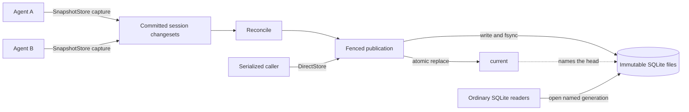

# fsqlite

[](https://x.com/ojoshe)
[](https://github.com/jlevy/fsqlite/actions/workflows/ci.yml)

**Portable, stable SQLite, packaged for concurrent agents.**

fsqlite is an agent-friendly store format and coordination strategy for ordinary SQLite
databases. Install this zero-runtime-dependency Node.js library, point cooperative
processes at a store directory, and keep using SQLite’s engine, SQL, transactions,
schema, constraints, tools, and file format.
Complete databases become immutable generations that writers can update without sharing
one live writable SQLite file.

Supported Node releases already include SQLite: Node 22.18+ on the 22.x line, or Node
24+. The package accesses that included SQLite library through the built-in
`node:sqlite` module.
Installing fsqlite therefore requires no separate SQLite installation or native build,
and fsqlite and direct `node:sqlite` calls use the same SQLite library supplied by Node.
This package is the first implementation of the language-independent `f1.0` commit
protocol.

> **Alpha phase:** `0.1.0` defines the first public API and the draft `f1.0` store
> format. Both may change before 1.0. The multi-process suite is extensive, but the real
> cross-host NFS/SMB validation gate is still pending.

## Why fsqlite Exists

A common agent setup puts one shared SQLite knowledge base on an NFS-backed workspace.
Several agents open the same path and write from separate processes.

Standard SQLite coordinates those writes with POSIX byte-range locks on one live
database file.
SQLite’s [network-filesystem guidance](https://sqlite.org/useovernet.html)
warns that exclusive locks can operate incorrectly on some network filesystems.
When the mount cannot provide the lock SQLite expects, the
[Unix VFS maps `ENOLCK` to `SQLITE_BUSY`](https://github.com/sqlite/sqlite/blob/002d33d8c569ce25f5001ae627a4e73dd52bf98d/src/os_unix.c#L1014-L1038)
and calls it a “random NFS retry error.”
In Node, a failed write looks like this:

> `Error: database is locked`
> ([`SQLITE_BUSY` (5)](https://sqlite.org/rescode.html#busy);
> [SQLite source](https://github.com/sqlite/sqlite/blob/002d33d8c569ce25f5001ae627a4e73dd52bf98d/src/main.c#L1649-L1657))

Waiting longer does not fix this: the NFS mount cannot supply the lock SQLite needs.
[A busy timeout](https://sqlite.org/pragma.html#pragma_busy_timeout) helps when another
process owns a working lock and will release it; it cannot make unavailable or
unreliable NFS locking work.
WAL is not a workaround because
[SQLite does not support WAL across a network filesystem](https://sqlite.org/wal.html#overview).
Some broken network locks can appear to work without coordinating clients correctly,
which risks database corruption.

fsqlite avoids the shared writable file.
Each agent works in a private SQLite file, and cooperative publishers expose complete
immutable generations through directory creation and atomic rename.
On a mount that meets the
[`f1.0` publication contract](#shared-filesystems-and-cloud-agents), agents can share
and update ordinary SQLite data without a database server.

## Core Properties

- **Portable SQLite files:** Every published generation is a complete database in the
  standard SQLite format.
  It moves unchanged across architectures and operating systems, opens with ordinary
  SQLite tools and bindings, and can be sealed as a plain file for archival or migration
  between environments.
- **Stable SQLite foundation:** The SQLite 3 file format has been
  [backward compatible since 2004](https://sqlite.org/formatchng.html), and the SQLite
  project [plans support through 2050](https://sqlite.org/lts.html).
  fsqlite retains SQLite’s [widely deployed](https://sqlite.org/mostdeployed.html)
  engine, SQL, transactions, schema, constraints, tooling, and file ecosystem.
- **SQLite included with Node:** Supported Node releases supply SQLite as part of the
  runtime and expose it through the built-in `node:sqlite` module.
  Application code and fsqlite use that same library.
  The npm package adds the coordination layer around it.
- **SQLite-native change capture:** `SnapshotStore` uses SQLite’s official
  [session extension](https://sqlite.org/sessionintro.html) to record row transactions
  in private copies and apply them with SQLite’s conflict-aware changeset API. Sessions
  are less familiar than WAL, but this upstream feature has shipped in the SQLite
  amalgamation since 3.13.0 in 2016. For cooperative clients that write independently in
  separate copies, sessions are SQLite’s native way to capture and merge row changes;
  fsqlite adds the atomic publication protocol around them.
  `SnapshotStore`’s only SQLite-build-specific requirement is `SQLITE_ENABLE_SESSION`
  with `SQLITE_ENABLE_PREUPDATE_HOOK`; supported Node versions enable both.
  Readers and `DirectStore` need ordinary SQLite only.
- **Concurrency-safe publication:** Immutable generations, an atomic `current` pointer,
  fencing, optimistic publication, and an exactly-once ledger protect published state
  through process crashes and racing publishers.
- **Server-free operation:** Deployment needs only cooperative processes and a store
  directory; no database server, daemon, or background service is required.
- **Language-independent protocol:** The on-disk format and commit protocol can be
  implemented in any language; Node.js is the first reference implementation.

## What fsqlite Adds to SQLite

fsqlite keeps SQLite intact and adds a file-level coordination layer:

| Layer | Supplied by | Role |
| --- | --- | --- |
| Database engine and file format | SQLite | SQL, transactions, schemas, constraints, queries, and complete portable database files |
| Logical change capture | SQLite session extension | Records row changes and applies them later with conflict detection |
| Store and commit protocol | [`f1.0`](https://github.com/jlevy/fsqlite/blob/main/docs/fsql-format-spec.md) | Transaction envelopes, immutable generations, `current`, fencing, validation, an exactly-once ledger, and quarantine |
| Reference package | TypeScript and Node built-ins | Uses Node’s included SQLite and implements the protocol as a convenient npm library and CLI |

The durable artifact is a standard SQLite database plus the surrounding `f1.0` directory
protocol. fsqlite defines no new storage engine or SQL dialect.
Ordinary readers open the published SQLite file directly; cooperative writers use
fsqlite to coordinate which complete file is current and how independent changes reach
it.
In Node, both paths execute against the same SQLite library that direct `node:sqlite`
calls use.

## Why fsqlite Is Practical Now

SQLite’s session extension has been upstream since 2016, but it is compile-time optional
and remains absent from many common bindings.
That kept logical changesets less visible than WAL and page replication.
Node releases supported by fsqlite include SQLite compiled with `SQLITE_ENABLE_SESSION`
and `SQLITE_ENABLE_PREUPDATE_HOOK`. The built-in `node:sqlite` module exposes sessions,
changeset application, backup, and ordinary SQLite access together.
Node supplies the database engine and native integration; fsqlite supplies the
TypeScript coordination layer.
That division makes a small zero-runtime-dependency npm package practical.

Most distributed SQLite systems chose a different deployment model: WAL or page
replication, a primary or daemon, consensus, a storage service, or custom readers.
fsqlite combines SQLite’s row-level changesets with immutable generations and an atomic
filesystem commit point.
The individual pieces are established; the `f1.0` protocol and their server-free
integration are the new contribution.
The
[research report](https://github.com/jlevy/fsqlite/blob/main/docs/research/research-2026-06-06-portable-concurrent-sqlite.md)
contains the source analysis, prior-art review, and comparison matrix behind this
design.

## Should You Use fsqlite?

Choose a storage model from the way writers coordinate and when updates must become
visible. A single machine can have many independent writers, while several callers can
sometimes share one serialized writer lane.
Writer independence, visibility, isolation, snapshot size, and write cadence determine
the fit:

Here, an “agent” is an independently running cooperative process with its own store
handle. Threads sharing one SQLite connection belong to a different coordination model.
A fixed dataset can be shared directly as a read-only SQLite file.
fsqlite becomes relevant when the shared data evolves: cooperative writers need a safe
publication path while agents continue reading complete generations.

| Situation | Default choice | Why |
| --- | --- | --- |
| One embedded application owns a database on a reliable local filesystem | Ordinary SQLite, often with WAL | It is simpler, provides immediate serializable transactions, and writes changed pages instead of copying a complete snapshot. |
| Several independent agents update compact shared state on a local or capability-validated shared path, captures may overlap, and visibility may wait for reconciliation | `SnapshotStore` | Each agent captures its transaction without the publish lease or a shared writable SQLite file; reconciliation merges and publishes the next immutable generation. |
| Cooperative callers need immutable generations or use a capability-validated path without reliable SQLite locks, can serialize the complete callback, and need each return to be immediately published | `DirectStore` | A filesystem lease serializes copy, transaction, validation, and publication. Multiple callers may queue, but only one write lane runs at a time. |
| Many writers need low-latency globally visible commits, high sustained throughput, rolling schemas, or serializable range and cross-row invariants | A client/server database or coordinator | Those requirements need a live coordination service or a different concurrency-control model. |

`SnapshotStore` is the main fsqlite strategy for the common multi-agent case.
It fits agents that need independent capture or should not coordinate through SQLite
locks on one live file, and it trades immediate visibility and serializability for that
independence. `DirectStore` fits agents that need the same immutable publication format
but can serialize every complete callback.
Ordinary SQLite remains the simpler choice for a single embedded owner, or whenever its
live-file coordination model reliably meets the workload.

The
[coordination-model design](https://github.com/jlevy/fsqlite/blob/main/docs/fsqlite-design.md#choose-by-coordination-model)
develops this decision from visibility, isolation, snapshot size, and writer
independence.

fsqlite buys immutable published states, explicit recovery points, and file-native
coordination without a required service.
It pays for those properties with a full-head copy for every write, delayed cross-writer
visibility, more transient disk use, and a multi-writer merge model that is not
serializable. Agent count alone does not determine fit: snapshot bytes multiplied by
write rate and burst size determine most of the cost.

## Shared Filesystems and Cloud Agents

fsqlite targets shared paths that cannot provide SQLite’s live-file locking contract but
can provide the `f1.0` publication contract.
Both strategies require correct exclusive directory creation, atomic rename-replace,
close-to-open visibility, and file and directory fsync behavior from the exact mount.

This distinction matters in cloud-agent sandboxes, where a workspace path may be
network-backed or virtualized even when it looks local.
The
[research report](https://github.com/jlevy/fsqlite/blob/main/docs/research/research-2026-06-06-portable-concurrent-sqlite.md#d-why-nfssmbfusesync-folders-can-break-live-sqlite)
records Claude Code on the web as one observed example and separates that observation
from a stable product guarantee.

The alpha’s one-host `fsinspect` result is useful diagnostic evidence, not proof that an
arbitrary NFS or SMB deployment is safe across hosts.
Once a shared mount has real multi-host evidence, prefer `SnapshotStore` when local or
cloud agents should capture independently and converge later.
Prefer `DirectStore` when those agents can queue and each callback must observe the
latest published state.
Use a database service when the cloud environment makes one practical and the workload
needs immediate visibility, sustained throughput, or stronger transactions.

SQLite’s own guidance defines the baseline for an ordinary live database: use SQLite for
device-local storage with writers that can take turns, and use a client/server engine
when many writers cannot queue or when clients directly access data over a network.
fsqlite changes that boundary by requiring cooperative writers to publish immutable
files; it does not make arbitrary SQLite clients safe on a network drive.
See [Appropriate Uses For SQLite](https://sqlite.org/whentouse.html),
[Isolation In SQLite](https://sqlite.org/isolation.html), and
[Write-Ahead Logging](https://sqlite.org/wal.html).
The
[shared-path design](https://github.com/jlevy/fsqlite/blob/main/docs/fsqlite-design.md#shared-paths-and-cloud-agents)
explains the required filesystem evidence and deployment choices in detail.

## Architecture

An fsqlite store is a directory containing immutable SQLite generations, a `current`
pointer, and optional transaction envelopes:



`SnapshotStore.write()` runs a normal SQLite transaction on a private copy and records
the result with SQLite’s session extension.
It commits that changeset as a uniquely named envelope, so independent captures can
overlap. `reconcile()` applies accepted envelopes to another private copy, validates the
result, and publishes the next generation.
`DirectStore` skips the envelope step and serializes the complete copy-mutate-publish
path.

Replacing `current` is the store commit point.
The snapshot is written and fsynced first, so readers see either the previous complete
SQLite database or the next one.
Fencing, optimistic checks on `current`, and an in-snapshot transaction ledger protect
publication from racing publishers, stale leases, duplicate application, and process
crashes. The
[architecture design](https://github.com/jlevy/fsqlite/blob/main/docs/fsqlite-design.md#architecture)
covers the complete store layout, publication races, and consistency boundaries.

## Reference Implementation

This package’s reference implementation is 2,581 lines of TypeScript code, including the
CLI and excluding tests and generated output.
It uses only Node built-ins and has zero runtime dependencies.
Supported Node releases include SQLite and expose it through the built-in
[`node:sqlite`](https://nodejs.org/api/sqlite.html) module; fsqlite uses that module
with Node’s filesystem and cryptography APIs.
Node supplies the database engine and native integration, while the npm package supplies
the `f1.0` protocol implementation and CLI. Installing it requires no separate SQLite
installation, native add-on, or install-time build.

The `f1.0` format is language-independent, with Node serving as the first
implementation. Any SQLite binding can read a published generation.
A `SnapshotStore` implementation in another language needs a SQLite build compiled with
`SQLITE_ENABLE_SESSION` and `SQLITE_ENABLE_PREUPDATE_HOOK`, plus a binding that exposes
the session and changeset APIs.
Supported Node releases include SQLite with both options enabled and expose the session
and changeset APIs through `node:sqlite`. A `DirectStore` implementation and every
reader need ordinary SQLite only.
Either can implement the same filesystem protocol and interoperate through the same
store. The
[upstream source confirmations](https://github.com/jlevy/fsqlite/blob/main/docs/upstream-source-confirmations.md)
record the exact SQLite and Node capabilities behind the reference package.

## Install

```bash
npm install fsqlite@alpha
```

Requires Node `>=22.18.0 <23 || >=24.0.0`. The split range is intentional: fsqlite
statically imports the `node:sqlite` backup API introduced in Node 22.16, and its source
development loop also relies on type stripping stabilized in Node 22.18. Node 23 is not
an LTS line and versions before 23.8 cannot load the package.

## Quick Start

```ts
import { SnapshotStore } from 'fsqlite'

const store = new SnapshotStore('./example.fsqlite', {
  schema: `
    CREATE TABLE kv (
      key TEXT PRIMARY KEY NOT NULL,
      value TEXT NOT NULL
    )
  `,
  schemaVersion: 1,
  conflictPolicy: { kv: 'lww', '*': 'strict' },
}).init()

// A writer records an envelope without taking the publish lease.
store.write('worker-a', (db) => {
  db.prepare('INSERT INTO kv VALUES (?, ?)').run('answer', '42')
})

// Reconciliation folds pending envelopes into a new immutable snapshot.
store.reconcile()

const row = store.read((db) => db.prepare('SELECT value FROM kv WHERE key = ?').get('answer'))
console.log(row)
```

Every table must have a non-null primary key.
The `f1.0` writer contract does not support virtual tables or DDL inside write
callbacks. Conflict actions are `lww` (replace), `union` (keep the existing row), and
`strict` (quarantine the conflicting envelope).
The `'*'` default is `strict` when omitted.
The policy is deployment configuration rather than stamped `f1.0` store metadata, so
every reconciler for one store epoch must use the same effective policy.
`lww` means the incoming row wins in deterministic envelope application order; it is not
a causal or globally clock-ordered last-write guarantee across hosts.

Call `init()` on each application handle before ordinary use.
On an existing store it verifies the exact caller-schema identity rather than executing
the DDL again. `schemaVersion` is an integer from 0 through 2,147,483,647. Incrementing
it does not migrate a store; a different version or exact schema string is incompatible
until a future explicit migration protocol exists.

## Choose a Write Strategy

|  | `SnapshotStore` | `DirectStore` |
| --- | --- | --- |
| Best for | Independent agents that benefit from overlapping capture and can accept reconcile-based visibility | Cooperative callers that can queue through one synchronous publication lane |
| Write path | Capture an envelope, then reconcile | Copy, mutate, and publish synchronously |
| Session extension | Required for writers | Not required |
| Read path | Immutable published SQLite snapshot | The same |
| On-disk format | `f1.0` | `f1.0` |

Both strategies can open the same store.
`DirectStore` keeps the immutable publication and recovery model while removing the
envelope/reconcile step.
Several processes may call it, but the publish lease serializes their complete copy,
callback, validation, and publication path.
It still copies and fsyncs the complete published snapshot for each write, so it is a
semantic simplification rather than a large-database performance optimization.
Its callback may run more than once after a fencing or publication race, so keep
external side effects outside the callback or make them idempotent.
The
[write-strategy design](https://github.com/jlevy/fsqlite/blob/main/docs/fsqlite-design.md#two-write-strategies)
details each strategy’s lifecycle and guarantees.

## Changing an Application Schema

An `f1.0` store has one fixed caller-schema epoch.
The schema string and `schemaVersion` identify that epoch; changing either value rejects
the handle.
This is stricter than ordinary SQLite, where an application can run supported
`ALTER TABLE` operations in a normal write transaction.

The restriction exists because a SnapshotStore envelope contains row changes, not DDL.
SQLite’s session extension expects a compatible target schema.
Mixing envelopes from old and new schemas could otherwise reinterpret columns, defaults,
constraints, primary keys, or conflict policy without a safe ordering rule.

Until fsqlite has an explicit migration command, use an application-managed replacement:

1. Stop every writer and reconciler for the old store.
2. Reconcile acceptable pending envelopes and resolve any quarantine so the source has
   one deliberate final state.
3. Validate and seal that state for backup and rollback.
4. Create a separate store with the new schema.
   Copy or transform data through a working SQLite database that follows SQLite’s
   documented schema-change procedure when needed; never alter a published fsqlite
   snapshot in place.
5. Validate the destination, switch every process to it, and keep the old store until
   the rollback window closes.

This creates a replacement store with a new `store_id`; it is not an in-place fsqlite
migration or an atomic cross-process cutover supplied by this package.
The application must prevent old writers from continuing on the old path.
Even a normally compatible change such as adding a column starts a new epoch in `f1.0`.

The
[schema-change design](https://github.com/jlevy/fsqlite/blob/main/docs/fsqlite-design.md#schema-changes-in-practice)
explains the fsqlite protocol requirements.
SQLite documents its directly supported alterations and its general
create-copy-drop-rename procedure in
[ALTER TABLE](https://sqlite.org/lang_altertable.html).
A future fsqlite migration protocol must add writer admission, pending-envelope
treatment, validation, rollback, and cutover around those ordinary SQLite steps.

## A Store Identifies Itself

The directory passed to the constructor is the store root.
It contains a visible, machine-owned `fsqlite.json` marker:

```json
{
  "format": "fsqlite",
  "format_version": "f1.0",
  "required_features": [],
  "store_id": "550e8400-e29b-41d4-a716-446655440000"
}
```

Snapshots and transaction manifests repeat the format version and `store_id`, so mixed
or copied contents fail closed.
Snapshot databases carry SQLite `application_id` `0x4653514C` (`FSQL`); your schema owns
`PRAGMA user_version`.

The directory format and caller schema have separate identities.
`format_version: "f1.0"` identifies the fsqlite protocol.
The caller-schema identity is `schemaVersion` plus the first 16 lowercase hexadecimal
characters of SHA-256 over the exact UTF-8 schema string.
Whitespace or comments change that token even if the resulting SQLite schema would be
equivalent.

`recognizeStore()` distinguishes a missing marker, invalid metadata, unsupported
versions/features, and a supported store.
Opening a store never upgrades it.
Future format upgrades will be explicit, side-by-side operations that preserve
`store_id` and leave the source untouched until cutover.

The
[store-layout specification](https://github.com/jlevy/fsqlite/blob/main/docs/fsql-format-spec.md#2-store-layout)
defines the complete directory identity and structure.

## CLI

The CLI can inspect and maintain a store without application schema code:

```text
fsqlite info      <dir>
fsqlite validate  <dir>
fsqlite stats     <path> [--json]
fsqlite gc        <dir> [--retain N]
fsqlite seal      <dir> <out.sqlite>
fsqlite repair    <dir>
fsqlite doctor    <path> [--json] [--fix]
fsqlite fsinspect <dir> [--json]
```

Recognition and health have distinct exit codes: healthy `0`, in-flight `2`, invalid or
corrupt `3`, unsupported `4`, and not an fsqlite store `64`.

`seal` produces a standalone SQLite copy.
`stats` and `doctor` also accept a plain SQLite file.
`fsinspect` probes the local filesystem operations fsqlite depends on, but it is a
heuristic from one host, not a substitute for the pending multi-host gate.
Its safe verdict requires working directory fsync as well as the coordination
primitives. The QA runbook includes a
[manual CLI walkthrough](https://github.com/jlevy/fsqlite/blob/main/docs/qa-runbook.md#b3-cli-walkthrough-on-a-real-store)
and filesystem capability check.

## Correctness Model

Published snapshots are immutable, `current` is the atomic commit pointer, and every
changeset shares one SQLite transaction with its `applied_tx` ledger entry.
Replaceable same-primary-key conflicts follow the table policy.
NOTFOUND, CONSTRAINT, and FOREIGN_KEY outcomes quarantine the complete envelope, and
foreign keys are checked at envelope and publication boundaries.

Callbacks cannot change the SQLite schema, format identity, caller schema version, or
fsqlite-owned tables.
Maintenance fails closed on malformed identity, unsupported capabilities, unreadable
leases, or a missing clean recovery point.

Publication fsyncs the snapshot, pointer, and containing directories.
A required directory fsync failure aborts initialization or publication rather than
silently weakening the durability claim.
A successfully captured envelope survives process failure but is only guaranteed
power-loss durability after reconciliation publishes it.
An optional durable-envelope mode is future work.

The
[design constraints](https://github.com/jlevy/fsqlite/blob/main/docs/fsqlite-design.md#design-constraints)
state the complete guarantees, costs, and trust boundaries.
The
[format specification](https://github.com/jlevy/fsqlite/blob/main/docs/fsql-format-spec.md)
is the normative protocol authority.

## Limitations

- The format and API are alpha and may change.
- POSIX filesystems are the supported target for this alpha; Windows publication races
  are not yet validated.
- Cross-host NFS/SMB behavior is designed into the protocol but not yet proven by the
  real multi-host gate.
  Do not treat the alpha as that proof.
- The natural workload is a few to a few dozen cooperative local agents, short data
  callbacks, a single-digit-MiB head, occasional writes, and batched reconciliation.
  A handful of agents against a low-tens-of-MiB head can fit with background-latency
  tolerance, but requires measurement.
  Large or high-frequency workloads are a poor default fit.
- Reconciliation serializes publication, and visibility across writers occurs when
  reconciliation completes rather than immediately after envelope capture.
- Row-level policies do not by themselves protect arbitrary range, aggregate, or
  cross-row invariants.
  Use `strict` with retry for supported point-row invariants, or the serialized
  `DirectStore` strategy.
- `f1.0` requires every reconciler to receive the same effective conflict policy; the
  store does not yet verify policy identity.
- `SnapshotStore` seeds each default writer by copying the published snapshot, so write
  latency grows with snapshot size.
  Two runs of the maintained 2 KB-row benchmark measured median capture at 13.7 to 18.2
  ms for 2.0 MiB and 163.8 to 164.6 ms for 21.7 MiB. Eight child processes issuing 40
  total writes against 21.7 MiB took 8.4 to 8.9 seconds including startup.
  Treat these hardware-specific measurements as sizing evidence, not a portable rate or
  performance guarantee.
  Any faster seed must preserve the data and constraints the callback observes; safe
  large-store overlays, compaction, and shared-base alternatives remain on the
  [roadmap](https://github.com/jlevy/fsqlite/blob/main/docs/roadmap.md).
  Snapshot bytes create the unavoidable full-copy floor.
  Table count adds schema setup work and SQLite pages, but the calibration did not
  isolate an independent table-count slope.
  Batching reconciliation amortizes the build and publication, not the per-writer seed
  copy.
- Concurrent writers can transiently require one head-sized working copy each, in
  addition to retained snapshots, read leases, a reconcile build, and envelopes.
  Reconcile also loads the lifetime `applied_tx` ledger, which is not yet checkpointed.
  Monitor free space and pending backlog.
- DirectStore holds its lease across copy, callback, checks, fsync, and publication.
  Configure a stale window longer than the worst-case operation.
  A stolen lease is fenced safely but can cause the callback to retry.
- Use `readLease()`, `seal()`, or the backup helpers for live backups.
  `seal()` acquires its own read lease for the selected snapshot.
  An arbitrary recursive directory copy racing publication or garbage collection is not
  a supported backup contract.
- Write callbacks are data transactions over a fixed schema.
  Persistent and temporary DDL, including temporary tables and triggers, and virtual
  tables are outside the `f1.0` concurrent-writer contract.
  Caller-schema migration, including admission of old writers and handling old pending
  envelopes, is post-alpha work.

The
[schema and workload assessment](https://github.com/jlevy/fsqlite/blob/main/docs/research/research-2026-08-01-schema-evolution-and-workload-fit.md#practical-operating-envelope)
gives detailed severity, measurements, and adoption guidance.

## License

MIT © 2026 Joshua Levy.
See [LICENSE](https://github.com/jlevy/fsqlite/blob/main/LICENSE).

<!-- This document follows common-doc-guidelines.md.
See github.com/jlevy/practical-prose and review guidelines before editing.
-->
